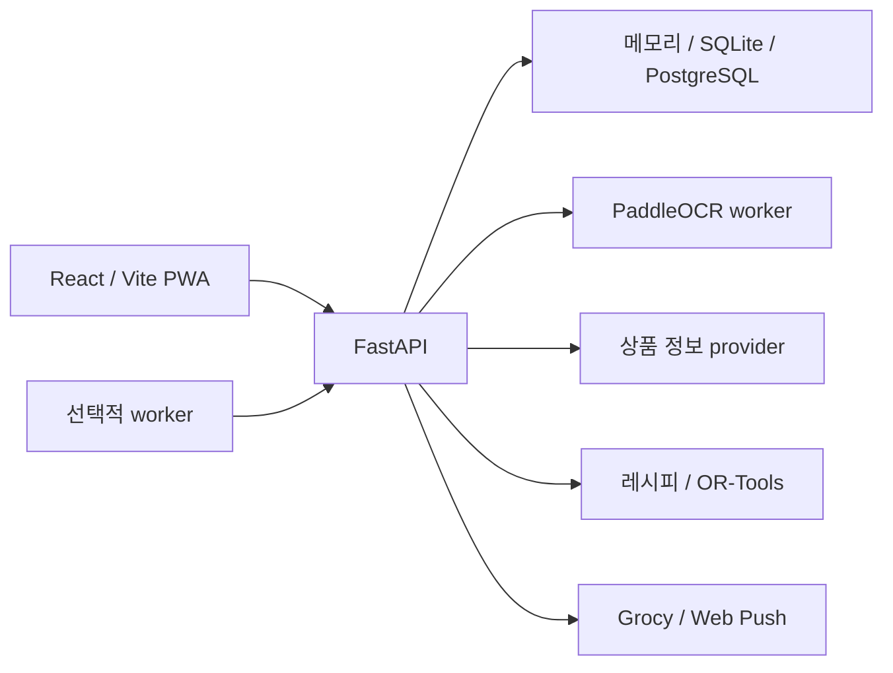

# 구조와 저장소

## 구성 요소

| 경로 | 역할 |
| --- | --- |
| `apps/web/src/` | React 화면, API transport, workspace 동기화 |
| `apps/web/tests/` | 브라우저·연결·viewport 및 클라이언트 계약 검증 |
| `services/api/app/` | API route, 인증, 저장소·도메인·외부 adapter |
| `services/api/app/pipeline/` | 이미지 품질, OCR adapter, 영수증·라벨·PDF 파싱 |
| `services/api/scripts/` | 사전 점검, worker runner, PostgreSQL smoke |
| `services/ocr-worker/` | 독립 Python 3.12 OCR 서비스 |
| `infra/postgres/` | 순서 있는 SQL migration과 백업·복구 도구 |
| `infra/gcp/` | GCP 배포 코드와 운영 구성 문서 |
| `data/fixtures/` | 재현 가능한 개발·검증 입력 |
| `docs/`, `evidence/` | 상세 계약과 날짜별 검증 증거 |

## 핵심 코드 진입점

- `apps/web/src/App.tsx`, `Prototype.tsx`: 앱 진입과 주요 사용자 화면.
- `apps/web/src/mealApi.ts`: API 호출 계약.
- `apps/web/src/workspaceSync.ts`: 요청·갱신 수명주기와 workspace 동기화.
- `services/api/app/main.py`: FastAPI route와 도메인 조립.
- `inventory_repository.py`, `normalized_inventory.py`: lot 변경과 normalized 저장 경계.
- `workspace_mutation.py`: 적용된 변경 경로의 snapshot·flush·복구.
- `operation_ledger.py`: 재시도 작업 식별과 replay/conflict 처리.
- `postgres_pool.py`, `postgres_connection.py`: 연결 대여·반납과 transaction 경계.

## 영속성·동시 수정

메모리는 fixture 개발용, SQLite는 로컬 영속성, PostgreSQL은 workspace별 영속 저장에 사용합니다. PostgreSQL normalized 모드는 `RESCUE_MEAL_INVENTORY_MODE=normalized`로 선택합니다.

현재 SQL 파일은 `001`부터 `026`까지 있습니다. **파일의 존재와 운영 DB에 적용됐다는 사실은 다릅니다.** schema authority는 ordered migration runner와 ledger이며, 기존 volume에 Docker init SQL이 자동 재실행된다고 가정하지 않습니다.

workspace revision 충돌은 새 상태를 확인해야 하는 `409` 경계입니다. 요청 재시도는 domain별 idempotency 계약을 따릅니다. 공통 mutation helper가 있다고 모든 route와 외부 서비스까지 하나의 transaction인 것은 아닙니다. Grocy 같은 외부 변경은 outbox와 별도 처리 경계를 갖습니다.

상세: [아키텍처 결정](https://github.com/godekd3133/rescue-meal/blob/main/docs/architecture-decisions.md) · [PostgreSQL 연결 수명주기](https://github.com/godekd3133/rescue-meal/blob/main/docs/postgres-connection-lifecycle.md) · [Grocy adapter](https://github.com/godekd3133/rescue-meal/blob/main/docs/grocy-adapter.md)
